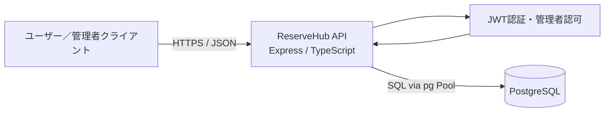
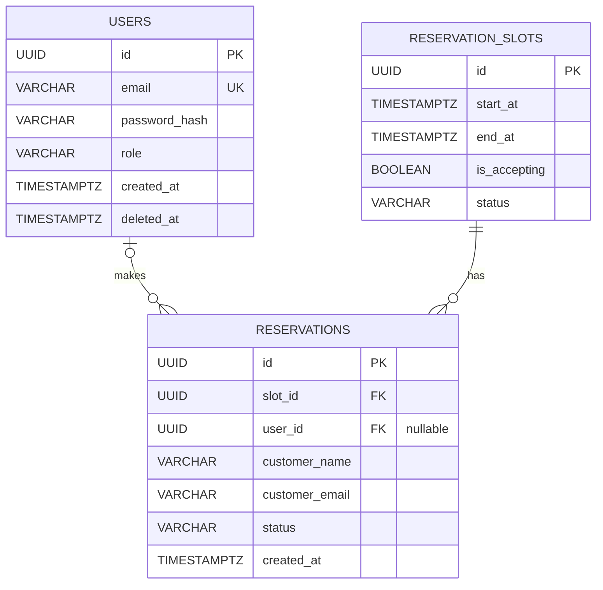

# ReserveHub API 基本設計書

- 文書種別：基本設計書
- 対象システム：ReserveHub 予約管理API
- 更新日：2026-11-09
- 対象実装：`src/` および `sql/schema.sql`
- 関連文書：[詳細設計書](./reservehub_detailed_design.md)、[フロントエンド向けAPIガイド](./frontend-api-guide.md)

## 1. システム概要

ReserveHub APIは、予約枠の公開・管理、ユーザーの予約登録・照会・キャンセル、ユーザーアカウント管理、および管理者向け月別集計を提供するWeb APIである。

アプリケーションはNode.js、Express、TypeScriptで構成し、PostgreSQLにデータを保存する。ユーザー認証にはJWTを使用する。予約登録・キャンセルでは予約枠と予約データの更新をトランザクションで扱い、予約枠の条件付き更新とデータベース制約で二重予約を防ぐ。

## 2. システム構成

### 2.1 構成図

### 2.2 主な構成要素

| 要素 | 役割 |
| --- | --- |
| Express API | HTTPリクエストを受け付け、ルートに応じた処理を実行する |
| Routes / Middleware | URLと処理を対応付け、JWT認証および管理者権限を確認する |
| Controllers | リクエスト値の確認とHTTPレスポンスを担当する |
| Services | 業務ルールと予約処理のトランザクションを担当する |
| Repositories | PostgreSQLへのSQL実行を担当する |
| PostgreSQL | ユーザー、予約枠、予約を永続化する |

### 2.3 技術・運用前提

- アプリケーション：Node.js / Express / TypeScript
- データベース：PostgreSQL
- DBアクセス：`pg` の `Pool` / `PoolClient`
- 認証：JWT（HS256）
- API形式：JSON
- DB接続に失敗した場合、起動時の接続確認でサーバー起動を中止する。
- `DATABASE_URL`、`JWT_SECRET`、`PORT`、`NODE_ENV`、`CORS_ORIGIN`を環境変数で設定する。秘密値をソース管理対象に含めない。
- CORSはブラウザーからのクロスオリジンアクセスを制御するもので、APIの認証・認可を代替しない。

## 3. 利用者と機能

### 3.1 利用者

| 利用者 | 説明 |
| --- | --- |
| 未認証利用者 | ユーザー登録・ログイン、および公開予約枠の参照を行う |
| ログインユーザー | 自分のプロフィール・アカウントを管理し、自分の予約を登録・参照・キャンセルする |
| 管理者 | 管理者機能として予約枠を管理し、全予約および月別集計を参照する |

### 3.2 機能一覧

| ID | 機能 | 概要 |
| --- | --- | --- |
| F-01 | ユーザー登録・ログイン | アカウントを作成し、ログイン時にJWTを発行する |
| F-02 | アカウント管理 | 自分のプロフィール・メールアドレス・パスワードを管理し、アカウントを論理削除する |
| F-03 | 公開予約枠参照 | 指定日を起点とする7日間の予約枠一覧および予約枠詳細を取得する |
| F-04 | 予約登録 | 受付中かつ空いている予約枠を確保し、ログインユーザーの予約を登録する |
| F-05 | 自分の予約管理 | 自分の予約一覧・詳細を参照し、予約をキャンセルする |
| F-06 | 管理者向け予約枠管理 | 予約枠の一覧・詳細取得、作成・編集・削除を行う |
| F-07 | 管理者向け予約参照 | 全予約の一覧・詳細を参照する |
| F-08 | 月別予約集計 | 予約枠の開始日時を基準に、指定月の予約件数を集計する |

## 4. API基本設計

ベースパスは `/api` とする。認証が必要なAPIでは `Authorization` ヘッダーにBearer方式でJWTを指定する。認証失敗は401、権限不足は403を返す。

| Method | Endpoint | 認証・権限 | 概要 | 主な成功ステータス |
| --- | --- | --- | --- | --- |
| POST | `/api/auth/register` | 不要 | ユーザー登録 | 201 |
| POST | `/api/auth/login` | 不要 | ログイン・JWT発行 | 200 |
| GET | `/api/users/me` | user/admin | 自分のプロフィール取得 | 200 |
| PATCH | `/api/users/me` | user/admin | 自分のメールアドレス変更 | 200 |
| PATCH | `/api/users/me/password` | user/admin | 自分のパスワード変更 | 204 |
| DELETE | `/api/users/me` | user/admin | 自分のアカウントを論理削除 | 204 |
| GET | `/api/slots?date=YYYY-MM-DD` | 不要 | 指定日を含む7日間の予約枠一覧 | 200 |
| GET | `/api/slots/:id` | 不要 | 予約枠詳細 | 200 |
| POST | `/api/reservations` | user/admin | 自分の予約を登録 | 201 |
| GET | `/api/reservations` | user/admin | 自分の予約一覧 | 200 |
| GET | `/api/reservations/:id` | user/admin | 自分の予約詳細 | 200 |
| PATCH | `/api/reservations/:id/cancel` | user/admin | 自分の予約をキャンセル | 200 |
| GET | `/api/admin/slots` | admin | 全予約枠一覧 | 200 |
| GET | `/api/admin/slots/:id` | admin | 予約枠詳細 | 200 |
| POST | `/api/admin/slots` | admin | 予約枠作成 | 201 |
| PATCH | `/api/admin/slots/:id` | admin | 予約枠編集 | 200 |
| DELETE | `/api/admin/slots/:id` | admin | 予約枠削除 | 204 |
| GET | `/api/admin/reservations` | admin | 全予約一覧 | 200 |
| GET | `/api/admin/reservations/:id` | admin | 予約詳細 | 200 |
| GET | `/api/reports/monthly?month=YYYY-MM` | admin | 月別予約集計 | 200 |

一般ユーザーの予約一覧・詳細・キャンセルはJWTから得たユーザーIDに紐づくデータに限定する。予約登録時のユーザーIDもJWTから設定する。全予約の参照および予約枠管理は管理者専用とする。

## 5. データベース基本設計

### 5.1 ER図

### 5.2 テーブル概要

#### `users`（ユーザー）

| カラム | 型 | 制約・用途 |
| --- | --- | --- |
| `id` | UUID | 主キー |
| `email` | VARCHAR(255) | NOT NULL、UNIQUE |
| `password_hash` | VARCHAR(255) | NOT NULL、bcryptハッシュ |
| `role` | VARCHAR(20) | `user` / `admin` |
| `created_at` | TIMESTAMPTZ | NOT NULL、作成日時 |
| `deleted_at` | TIMESTAMPTZ | 論理削除日時、未削除時NULL |

#### `reservation_slots`（予約枠）

| カラム | 型 | 制約・用途 |
| --- | --- | --- |
| `id` | UUID | 主キー |
| `start_at` | TIMESTAMPTZ | NOT NULL、開始日時 |
| `end_at` | TIMESTAMPTZ | NOT NULL、`end_at > start_at` |
| `is_accepting` | BOOLEAN | NOT NULL、予約受付可否 |
| `status` | VARCHAR(20) | `available` / `reserved` |

#### `reservations`（予約）

| カラム | 型 | 制約・用途 |
| --- | --- | --- |
| `id` | UUID | 主キー |
| `slot_id` | UUID | NOT NULL、`reservation_slots.id`への外部キー |
| `user_id` | UUID | `users.id`への外部キー、現行スキーマではNULL可 |
| `customer_name` | VARCHAR(100) | NOT NULL、予約者名 |
| `customer_email` | VARCHAR(255) | NOT NULL、予約者メール |
| `status` | VARCHAR(20) | `confirmed` / `cancelled` |
| `created_at` | TIMESTAMPTZ | NOT NULL、作成日時 |

確定済み予約は1つの予約枠につき1件までとする部分UNIQUEインデックスを設定する。予約枠の開始・終了日時の組み合わせも一意とし、枠の開始日時検索用インデックスを設定する。実際のDDLは `sql/schema.sql` を正とする。

## 6. 主要な業務ルール

### 6.1 予約枠

- 公開一覧は `date` を起点とする7日間の開始日時で検索する。日付範囲の計算に使う共通タイムゾーンは実装で明示していない。
- 予約可能な枠は `status = available` かつ `is_accepting = true` とする。
- 管理者は枠を作成・編集・削除できる。予約済み枠の日時変更、および予約履歴がある枠の削除はできない。
- 予約枠の日時はPostgreSQLの `TIMESTAMPTZ` で保存する。

### 6.2 予約登録

1. 認証済みユーザーから予約枠ID、予約者名、メールアドレスを受け取る。
2. トランザクション内で、対象枠が空きかつ受付中の場合に限り枠を確保する。
3. 枠の確保に成功した場合、JWTのユーザーIDを使って予約を登録する。
4. すべて成功した場合にコミットし、途中で失敗した場合はロールバックする。
5. 対象枠が存在しない場合404、利用不可の場合409を返す。

### 6.3 予約照会・キャンセル

- ユーザーは自分の予約のみ参照・キャンセルできる。他ユーザーの予約は対象なしとして扱う。
- 管理者は管理者向けAPIから全予約を参照できる。
- キャンセルでは予約を `cancelled` に更新し、対応する予約枠を `available` に戻す。同一トランザクションで処理し、予約履歴は削除しない。
- キャンセル済み予約の再キャンセルは409とする。

### 6.4 ユーザー・管理者

- パスワードはbcryptでハッシュ化して保存し、平文では保存しない。
- ログイン成功時に1時間有効なJWTを発行する。JWTにはユーザーID（subject）とロールを含める。
- 管理者APIはJWT認証後に管理者ロールを確認する。
- アカウント削除は物理削除ではなく `deleted_at` による論理削除とする。

### 6.5 月別集計

指定された年月について、予約枠の開始日時がその月に含まれる予約を集計し、全件・確定済み・キャンセル済みの件数を返す。月境界は日本標準時（UTC+09:00）で計算する。エンドポイントは管理者専用とする。

## 7. エラー・HTTPステータス方針

| ケース | ステータス |
| --- | --- |
| 正常な取得・更新 | 200 |
| 登録成功 | 201 |
| 入力値不正 | 400 |
| 未認証またはJWT不正 | 401 |
| 管理者権限不足 | 403 |
| 対象データが存在しない | 404 |
| 予約枠の競合、既にキャンセル済み等 | 409 |
| 想定外のアプリケーション・DBエラー | 500 |
| 正常終了（レスポンス本文なし） | 204 |

エラー応答は主に `message` を含むJSONとする。想定外エラーでは内部SQLやスタックトレースをレスポンスに含めず、サーバーログに記録する。現行実装では、全エンドポイント共通のエラーコード形式や共通エラーミドルウェアは設けていない。

## 8. 非機能・実装方針

- SQLの値はプレースホルダーを使い、リクエスト値をSQL文字列に直接連結しない。
- DB接続は例外時にも解放する。トランザクションの境界はService層で管理する。
- 予約登録・キャンセルは同一DBトランザクションで関連データを更新する。
- 予約キャンセルでは行ロックを利用していないため、競合時の制御は条件付き更新とDB制約に依存する。
- 一覧APIにページネーションは実装されていない。
- CORS許可オリジンは `CORS_ORIGIN` で設定する。productionで未設定の場合はオリジン付きブラウザーアクセスを許可しない。
