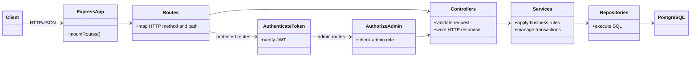
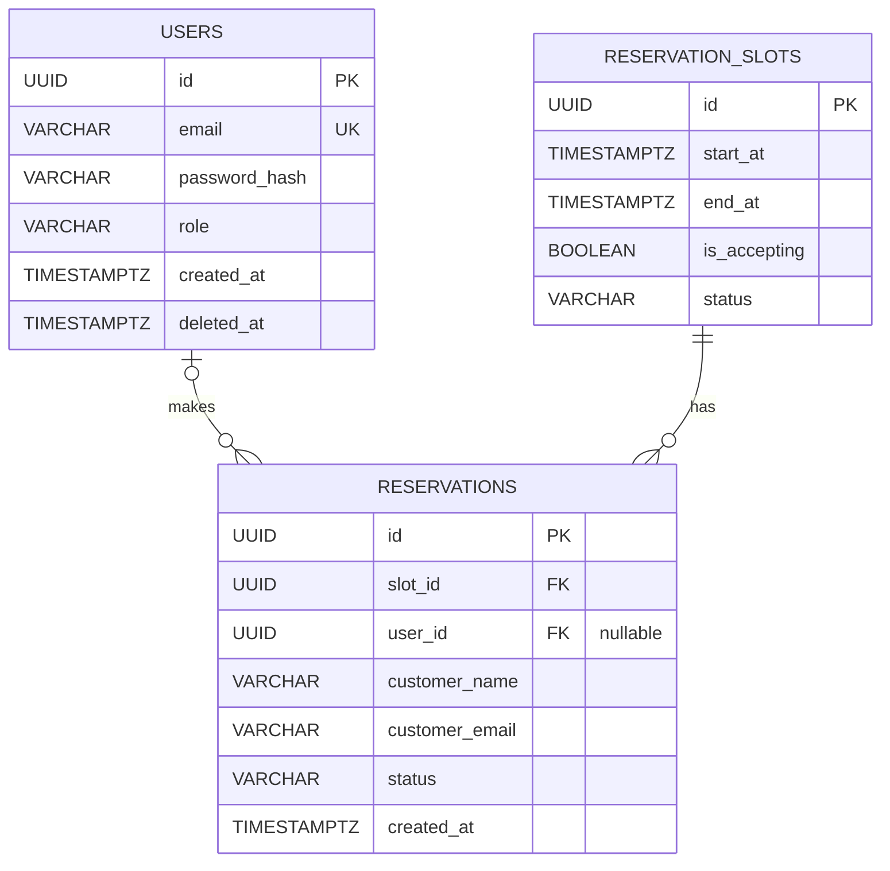
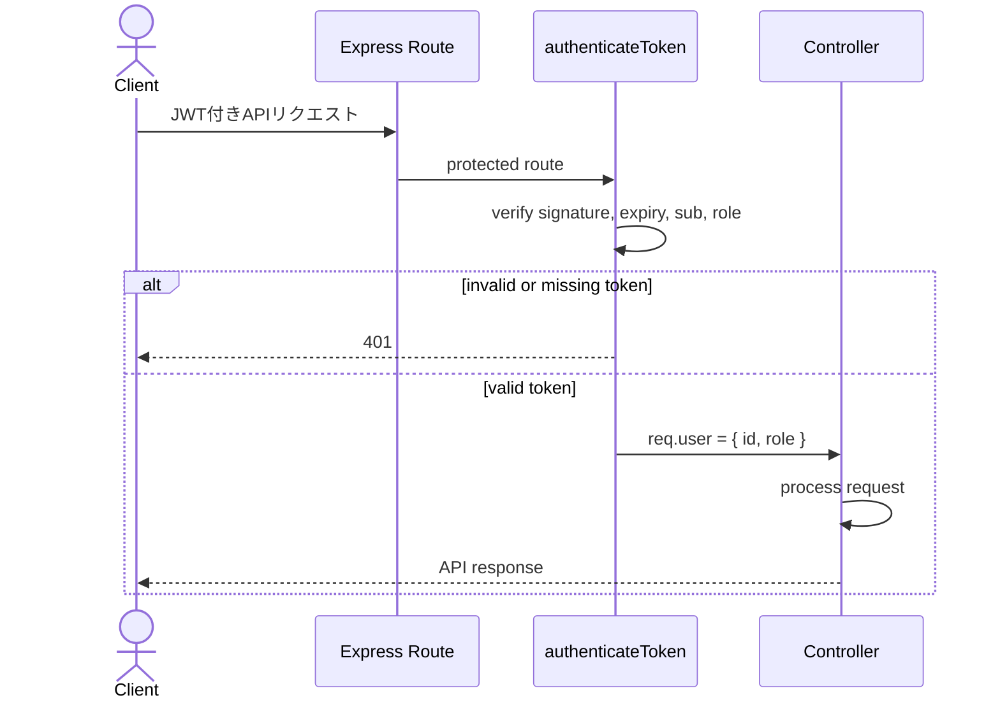
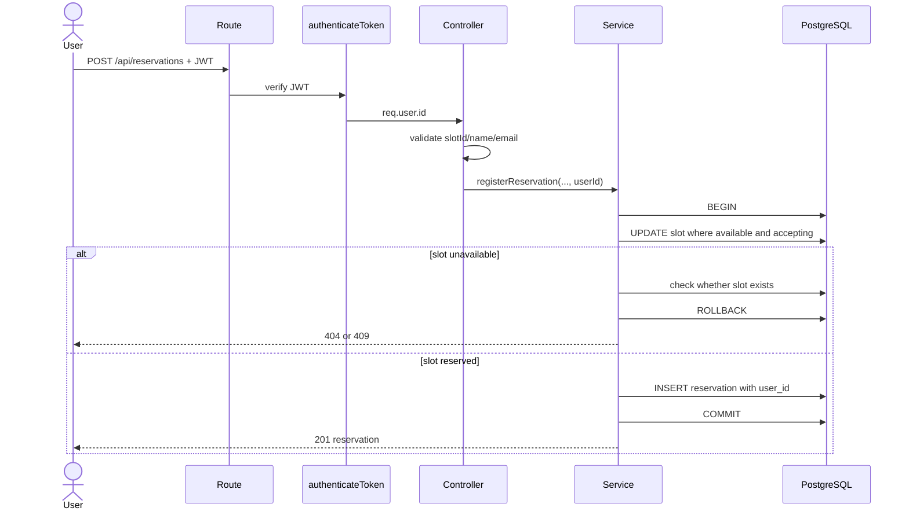
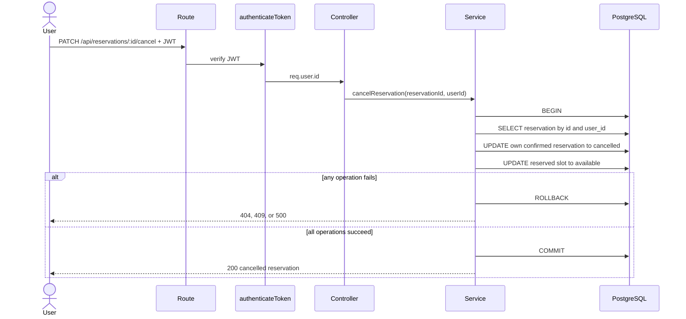

# ReserveHub API 詳細設計書

- 文書種別：詳細設計書
- 対象システム：ReserveHub 予約管理API
- 更新日：2026-11-09
- 対象実装：`src/` および `sql/schema.sql`
- 方針：本書は現在の実装に基づく。実装されていない仕様や将来案は、現行仕様として記載しない。

## 1. システム構成

### 1.1 ディレクトリ構成

```text
src/
├── app.ts
├── server.ts
├── db/
│   └── pool.ts
├── routes/
│   ├── auth_route.ts
│   ├── user_route.ts
│   ├── slot_route.ts
│   ├── reservation_route.ts
│   ├── admin_route.ts
│   └── report_route.ts
├── middleware/
│   ├── authenticateToken.ts
│   └── authorizeAdmin.ts
├── controllers/
│   ├── auth.controller.ts
│   ├── user.controller.ts
│   ├── slot.controller.ts
│   ├── reservation.controller.ts
│   └── report.controller.ts
├── services/
│   ├── auth.service.ts
│   ├── user.service.ts
│   ├── slot.service.ts
│   ├── reservation.service.ts
│   └── report.service.ts
├── repositories/
│   ├── user.repository.ts
│   ├── slot.repository.ts
│   ├── reservation.repository.ts
│   └── report.repository.ts
├── errors/
│   ├── app.error.ts
│   └── reservation.error.ts
└── types/
    └── express.d.ts
```

### 1.2 レイヤー構成図（UMLクラス図）



- `routes` はURL・HTTPメソッドとControllerを対応付け、必要な認証・管理者認可を設定する。
- `controllers` はリクエスト値を検証し、Serviceの結果をHTTPレスポンスにする。
- `services` は業務ルールを適用する。予約登録・キャンセルのトランザクションも管理する。
- `repositories` はSQLを実行する。
- `server.ts` はDB接続確認後にHTTPサーバーを起動する。

## 2. 実行環境と設定

| 環境変数 | 必須 | 用途 |
| --- | --- | --- |
| `PORT` | 任意 | 待受ポート。未設定時は `3000` |
| `DATABASE_URL` | 必須 | PostgreSQL接続文字列 |
| `JWT_SECRET` | 必須 | JWTの署名・検証に使う秘密鍵 |
| `NODE_ENV` | 任意 | `production`時のCORS既定動作を切り替える |
| `CORS_ORIGIN` | 任意 | 許可するオリジン。複数指定はカンマ区切り |

`NODE_ENV` が `production` 以外で `CORS_ORIGIN` が未設定の場合、CORSは `http://localhost:5173` を許可する。productionで未設定の場合、ブラウザーからのオリジン付きリクエストは許可しない。CORSはブラウザーのクロスオリジン制御であり、APIの認証・認可の代替ではない。

起動時に `SELECT 1` を実行し、DB接続に失敗した場合はサーバーを起動しない。

## 3. データベース設計

### 3.1 ER図（UML）



### 3.2 テーブル・制約

`sql/schema.sql` の定義を示す。`reservations.user_id` は既存テーブルへの `ALTER TABLE` で追加され、現状はNULLを許可する。

| テーブル | 主な列・ルール |
| --- | --- |
| `users` | `id` はUUID主キー、`email` は一意、`password_hash` にハッシュ化したパスワードを保存、`role` は `user` または `admin`、`deleted_at` は論理削除日時 |
| `reservation_slots` | `start_at` / `end_at` は日時、`end_at > start_at`、`is_accepting` は受付可否、`status` は `available` または `reserved` |
| `reservations` | `slot_id` は予約枠への外部キー、`user_id` はユーザーへの外部キー（NULL可）、`status` は `confirmed` または `cancelled` |

- 確定済み予約は予約枠ごとに1件まで（`uq_reservations_active_slot` 部分UNIQUEインデックス）。
- 予約枠の開始・終了日時の組み合わせは重複不可（`uq_reservation_slots_datetime`）。
- 予約枠の開始日時検索用インデックスを持つ。
- 予約レコードはキャンセル後も削除せず履歴として保持する。

### 3.3 状態遷移

予約枠：

```text
available --予約成功--> reserved
reserved  --予約キャンセル成功--> available
```

予約：

```text
confirmed --キャンセル成功--> cancelled
```

`is_accepting = false` の枠は、状態が `available` でも予約登録できない。

## 4. 認証・認可

### 4.1 認証方式

- 登録：メールアドレスを小文字化・前後空白除去して保存し、パスワードはbcrypt（cost 12）でハッシュ化する。パスワードは8文字以上、UTF-8で72バイト以下。
- ログイン：JWTを発行する。有効期間は1時間、署名方式はHS256。JWTのsubject (`sub`) にユーザーID、claim `role` にロールを設定する。
- 保護対象APIでは、AuthorizationヘッダーにBearer方式でJWTを指定する。
- `authenticateToken` は署名・期限・subject・roleを検証し、`req.user` に `id` と `role` を設定する。
- 管理者APIは認証に加えて `authorizeAdmin` による `role === "admin"` の確認を行う。

### 4.2 認可ルール

- ユーザー自身の予約一覧・詳細・キャンセルは、JWTから取得したユーザーIDで対象を限定する。
- 予約作成時の `user_id` はJWTから設定し、リクエストボディのユーザーIDは使わない。
- プロフィール、メールアドレス、パスワード、アカウント削除は `/users/me` 系APIで認証ユーザー自身に対して実行する。
- 全予約の閲覧および予約枠の管理は管理者専用とする。
- 予約枠の一般公開読み取りは認証不要。

### 4.3 認証処理シーケンス図（UML）



## 5. API仕様

### 5.1 共通仕様

- ベースパス：`/api`
- リクエスト・レスポンス：JSON（204の場合はレスポンス本文なし）
- 認証が必要なAPIでは、AuthorizationヘッダーにBearer方式でJWTを指定する。
- 成功時のJSONはエンドポイントによりDB列名（snake_case）またはAPI用キー（camelCase）を返す。全API共通のレスポンスラッパーは設けていない。
- ControllerはIDが空でないことを確認するが、UUID形式を一律に事前検証してはいない。無効な形式がDBエラーになった場合、該当処理によっては500となる。
- エラー本文は主に `{ "message": "..." }` 形式。入力不備は400、認証失敗は401、権限不足は403、対象なしは404、業務上の競合は409、想定外エラーは500。
- 一覧APIにページネーションは実装されていない。

### 5.2 エンドポイント一覧

| Method | Path | 認証・権限 | 概要 |
| --- | --- | --- | --- |
| POST | `/api/auth/register` | 不要 | ユーザー登録 |
| POST | `/api/auth/login` | 不要 | ログイン、JWT発行 |
| GET | `/api/users/me` | user/admin | 自分のプロフィール取得 |
| PATCH | `/api/users/me` | user/admin | 自分のメールアドレス変更 |
| PATCH | `/api/users/me/password` | user/admin | 自分のパスワード変更 |
| DELETE | `/api/users/me` | user/admin | 自分のアカウントを論理削除 |
| GET | `/api/slots?date=YYYY-MM-DD` | 不要 | 指定日を起点とする7日間の枠一覧 |
| GET | `/api/slots/:id` | 不要 | 予約枠詳細 |
| GET | `/api/reservations` | user/admin | ログインユーザー自身の予約一覧 |
| GET | `/api/reservations/:id` | user/admin | 自分の予約詳細 |
| POST | `/api/reservations` | user/admin | 予約登録 |
| PATCH | `/api/reservations/:id/cancel` | user/admin | 自分の予約をキャンセル |
| GET | `/api/admin/slots` | admin | 全予約枠一覧 |
| GET | `/api/admin/slots/:id` | admin | 予約枠詳細 |
| POST | `/api/admin/slots` | admin | 予約枠作成 |
| PATCH | `/api/admin/slots/:id` | admin | 予約枠更新 |
| DELETE | `/api/admin/slots/:id` | admin | 予約枠削除 |
| GET | `/api/admin/reservations` | admin | 全予約一覧 |
| GET | `/api/admin/reservations/:id` | admin | 予約詳細 |
| GET | `/api/reports/monthly?month=YYYY-MM` | admin | 月別予約集計 |

### 5.3 認証・ユーザーAPI

#### 登録・ログイン

- 登録リクエスト：`{ "email": "...", "password": "..." }`
- 登録成功：201。応答は `{ "id", "email" }`。roleはDB既定値の `user`。
- ログイン成功：200。応答は `{ "accessToken", "user": { "id", "email", "role" } }`。
- 登録済みメールアドレスは409、形式不正は400、ログイン失敗は401。

#### `/api/users/me` 系

- プロフィール取得は `id`, `email`, `role`, `createdAt` を返す。
- メール変更リクエスト：`{ "email": "..." }`。成功時200。
- パスワード変更リクエスト：`{ "currentPassword": "...", "newPassword": "..." }`。成功時204。現在のパスワード不一致は401。
- アカウント削除成功時204。ユーザー行を物理削除せず `deleted_at` を設定する。

### 5.4 予約枠API

- 一般向け一覧の `date` は `YYYY-MM-DD`。実在する日付でなければ400。Serviceで7日後の日付を計算し、開始日時が `[date, date+7日)` にある枠を検索する。明示的なアプリ共通タイムゾーン設定は行っていない。
- 予約枠一覧・詳細は `reservation_slots` の行を返す（DB列名を含む）。詳細取得で対象がなければ404。
- 管理者による作成リクエスト：`{ "startAt": "...", "endAt": "..." }`。日時の妥当性確認と既存枠との時間重複確認を行い、成功時201。
- 管理者による更新リクエスト：`{ "startAt": "...", "endAt": "...", "isAccepting": true }`。成功時200。予約済み枠の日時は変更できないが、受付可否は更新できる。
- 管理者による削除成功時204。予約済み、または予約履歴が存在する枠は削除できず409。
- 存在しない枠の更新・削除は404、時間重複は409。

### 5.5 予約API

予約登録リクエスト：

```json
{
  "slotId": "00000000-0000-4000-8000-000000000001",
  "customerName": "山田花子",
  "customerEmail": "hanako@example.com"
}
```

- `slotId`、`customerName`、`customerEmail` は空でない文字列が必須。これ以外の形式・長さの検証はControllerでは行わない。
- 成功時201。予約行（`reservations` のDB列名）を返す。`user_id` は認証済みユーザーID。
- 枠が存在しない場合404。空き状態でない、または受付停止中の場合409。
- 自分の予約一覧は `user_id` で絞り込み、作成日時の降順で返す。
- 自分の予約詳細・キャンセルは予約IDと認証済みユーザーIDの両方で対象を検索する。他ユーザーの予約は対象なしとして404。
- 管理者の予約一覧・詳細は `/api/admin/reservations` 系を使う。
- キャンセル成功時200で、キャンセルされた予約のIDと枠IDを返す。予約が見つからない場合404、キャンセル済み等の競合は409。

### 5.6 月別レポート

- `month` は `YYYY-MM`。形式または月の値が不正な場合400。
- 月の境界は日本標準時（`+09:00`）で計算する。
- 予約枠の `start_at` が月初以上、翌月月初未満の予約を集計する。
- 成功時200。`{ "month", "totalReservations", "confirmedReservations", "cancelledReservations" }` を返す。

## 6. 主要処理シーケンス（UML）

### 6.1 予約登録



### 6.2 予約キャンセル



## 7. トランザクション・競合制御

予約登録・キャンセルはServiceで `pool.connect()` し、同一の `PoolClient` で `BEGIN`、更新、`COMMIT` を実行する。失敗時は `ROLLBACK` を試み、`finally` でクライアントを解放する。

予約登録では `status = 'available'` かつ `is_accepting = TRUE` の枠だけを条件付きUPDATEする。更新に成功したリクエストのみ予約をINSERTする。DBの部分UNIQUEインデックスも確定済み予約の重複を防ぐ。

キャンセルではユーザーIDも条件に含めて予約を取得・更新し、同じトランザクション内で枠を `available` に戻す。現行実装では `SELECT ... FOR UPDATE` による行ロックは行っていない。

## 8. エラー応答

Controllerが例外を捕捉し、`AppError` または `ReservationError` の場合は保持するHTTPステータスとメッセージを返す。その他の例外はログに出力し、500を返す。共通のExpressエラーミドルウェアや統一されたエラーコード形式は実装されていない。

| 状況 | HTTPステータス |
| --- | --- |
| 入力不備 | 400 |
| 未認証・JWT不正 | 401 |
| 管理者権限なし | 403 |
| 対象データなし | 404 |
| 予約枠の競合・操作不可 | 409 |
| 想定外の例外 | 500 |

## 9. 手動確認項目

| No. | 確認内容 | 期待結果 |
| --- | --- | --- |
| 1 | トークンなしで保護APIにアクセス | 401 |
| 2 | userロールで管理者APIにアクセス | 403 |
| 3 | 日付形式・実在性が不正な枠一覧を要求 | 400 |
| 4 | 存在しない予約枠を取得 | 404 |
| 5 | 空き・受付中の枠を予約 | 201、予約行にログインユーザーのID |
| 6 | 受付停止中または予約済み枠を予約 | 409 |
| 7 | 他ユーザーの予約詳細・キャンセルを要求 | 404 |
| 8 | 所有者が予約をキャンセル | 200、予約はcancelled、枠はavailable |
| 9 | 同じ枠へ並行して予約 | 確定予約は1件のみ |
| 10 | 月別レポートの形式不正な年月を要求 | 400 |
| 11 | 自分のメールアドレスを変更 | 200 |
| 12 | 正しい現在のパスワードでパスワード変更 | 204 |
| 13 | アカウント削除後に同じユーザーでログイン | ログイン失敗 |

## 10. 実装との差分・留意事項

- 旧版の記載と異なり、現在はJWT認証とユーザー／管理者の認可が実装されている。
- 旧版のディレクトリ名・ファイル名（`*.routes.ts`、`middlewares/` 等）は現行と異なるため、本書では実ファイル名に更新した。
- 現行スキーマには `users`、`reservations.user_id`、`reservation_slots.is_accepting`、日時重複防止インデックスがある。
- 予約一覧は全件公開ではなく、一般ユーザーは本人の予約のみ取得する。全件閲覧は管理者APIに分離されている。
- 旧版に記載していた「UUIDをDB問い合わせ前に検証」「すべての不正UUIDは400」「共通エラーミドルウェア」「統一エラー形式」は現行実装では保証されない。
- 予約登録の入力検証は必須文字列の確認が中心で、メール形式や文字数の検証は行っていない。
- 予約キャンセルに行ロックはなく、競合時の厳密な直列化は実装されていない。
- `reservations.user_id` はNULL可のため、認証導入前の予約やユーザーに紐づかないデータが残る可能性がある。
